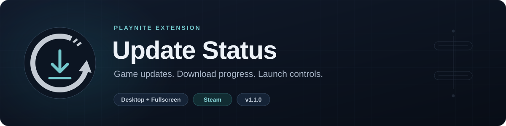
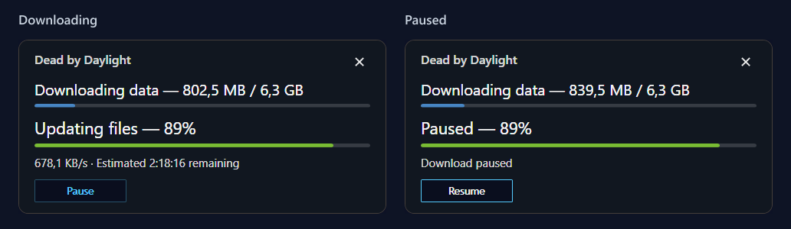
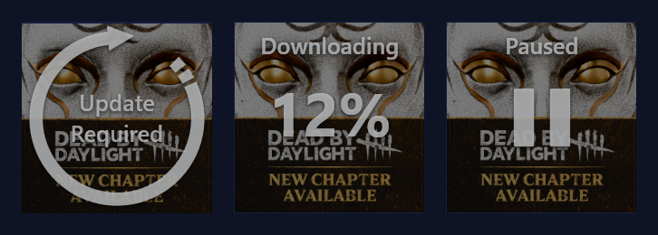
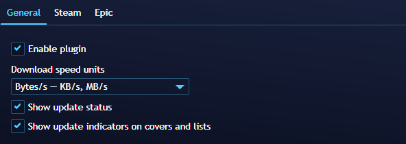
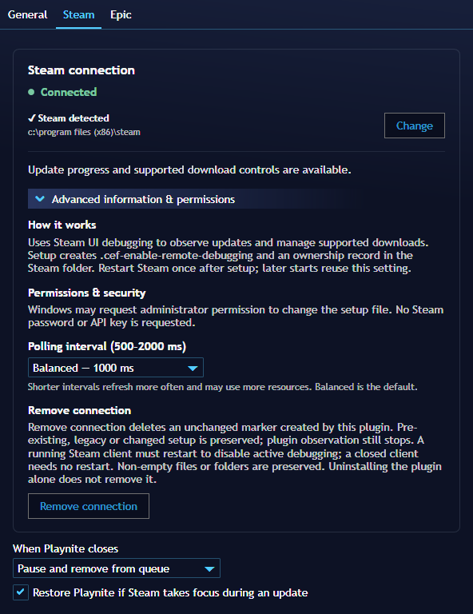
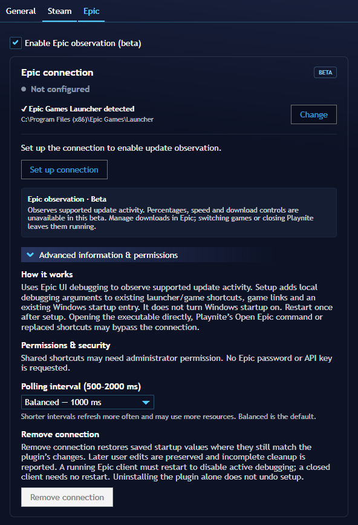

<p align="center">
  
</p>

<p align="center">
  <a href="https://github.com/AwaDensetsu/UpdateStatus/releases/download/v1.2.0/UpdateStatus_1.2.0.pext"><strong>Download v1.2.0</strong></a> ·
  <a href="#installation">Installation</a> ·
  <a href="#features">Features</a> ·
  <a href="#screenshots">Screenshots</a> ·
  <a href="#settings">Settings</a> ·
  <a href="CHANGELOG.md">Changelog</a>
</p>

---

Update Status is a Playnite plugin that shows Steam update progress in your library, adds Pause/Resume controls and lets the selected game launch after its update finishes. It also includes experimental update observation for the Epic Games Launcher.

I originally made this for my own library and decided to share it. Feedback and bug reports are welcome.

> **Epic observation is optional and experimental.** It is off by default on new installations. Existing saved choices are preserved. Steam has been tested in real Playnite use; validation with a genuine Epic game update is still pending.

## Features

### Steam

- Download size, speed and estimated time remaining.
- Separate progress bars for downloading and updating files.
- Update indicators on recognizable covers and game lists.
- Pause, Resume and queue removal from Playnite.
- Launch the selected game when its required update finishes.
- Observe updates that started before Playnite opened.
- Remember confirmed update requirements between Playnite restarts.

Cover percentages show **downloaded data**. Once downloading finishes, the indicator shows the current processing stage. File work remains a separate bar in the detailed card.

### Epic Games — beta

- Experimental observation of update requirements and active update activity.
- Cover/list indicators and a selected-game status card.
- A separate connection/settings page for the stock Epic Games Launcher.

**Epic percentages, speed, file stages and Pause/Resume/Cancel are not available in this beta.** Downloads and game launches stay under Epic's control. The status card's × hides the card; it does not cancel the download. See [Epic beta details](BETA.md).

The plugin supports Playnite's Desktop and Fullscreen modes. Indicator placement can vary with custom themes.

## Screenshots

### Steam update progress

Separate download and file progress, with Pause/Resume controls. Appearance follows your Playnite theme.

<p align="center">
  
</p>

### Cover indicators

The same game cover with Update Required, Downloading and Paused indicators.

<p align="center">
  
</p>

<details>
<summary><strong>Settings: General, Steam and Epic</strong></summary>

**General**



**Steam**



**Epic Games — beta**



</details>

## Installation

1. Download the `.pext` installer using the download link above.
2. Open Playnite in Desktop mode and drag the file into the window.
3. Confirm installation and restart Playnite when prompted.
4. Open **Main menu → Add-ons → Extension settings → Generic → Update Status**.

Use games imported through Playnite's official Steam or Epic library integration.

### Connect a launcher

1. Open the **Steam** settings tab. For Epic, open **Epic** and turn on **Enable Epic observation (beta)** first. Check the detected installation folder; use **Change** or **Browse** if needed.
2. If the card says **Not configured**, click **Set up connection**.
3. When it says **Restart required**, use **Restart Steam/Epic** and confirm, or close and reopen the launcher yourself. Restarting can interrupt downloads or games.
4. Wait for **Connected**, which means live communication has been verified. A configured but closed launcher shows **Not running** and offers **Launch**.

Windows may request administrator permission for setup. No launcher password, API key or separate account is requested.

Setup enables the launcher's local UI debugging connection. It remains configured after Playnite closes. **Advanced information & permissions** explains setup and contains **Remove connection**. Successful removal stops that launcher's observation and clears its saved update information; a running launcher needs a restart to disable its active connection. Disabling Epic observation stops monitoring but keeps its saved connection setup. Use removal before uninstalling. Pre-existing or subsequently changed setup is preserved where appropriate.

Epic setup applies to supported shortcuts, game links and an existing Windows startup entry. Direct executable launches, Playnite's **Open Epic** command or shortcuts replaced by Epic can bypass it. [More about Epic startup](BETA.md#connection-and-startup).

## Steam controls

- **Play:** wait for the selected game's required update, then continue its normal Playnite launch.
- **Pause:** pause all Steam downloads and cancel the selected game's pending launch.
- **Resume:** resume downloads and restore the selected game's pending launch.
- **×:** pause downloads, remove the selected update from the queue and cancel its pending launch. If removal cannot be confirmed, the card allows a retry and the game remains cancelled.
- **Play another game:** cancel the previous pending launch and remove its selected update from the queue before starting the new selection.
- **Browse the library:** keep the current update and pending launch active.

Steam shutdown/restart interrupts a retained launch. Reopen Steam and press **Play** again; reconnecting alone does not restart a cancelled game launch. Custom launch actions or requests already forwarded to Steam may behave differently.

## Settings

Preferences apply across Desktop and Fullscreen. Each launcher keeps its own connection and supported behavior.

- **General:** enable the plugin, choose speed units, show/hide the detailed status card and show/hide cover/list indicators.
- **Steam:** connection, polling interval, focus restoration and what happens to the selected update when Playnite closes.
- **Epic:** enable/disable beta observation, connection and polling interval.

Polling presets are **Fast (500 ms)**, **Balanced (1000 ms)** and **Low overhead (2000 ms)**. Existing custom values are preserved.

Steam's normal-shutdown options are **Keep current state**, **Pause and keep in queue** and **Pause and remove from queue**. The default is **Keep current state**. These options apply while the plugin is managing a selected Steam update; closing Playnite leaves Epic downloads running.

## Notes

The integrations use internal launcher UI interfaces, which can change with launcher updates. Missing or stale data produces a waiting/unavailable state rather than assumed progress or completion.

Steam and Playnite were tested with the versions available during development. Behavior on older or future versions has not been verified. Genuine Epic update validation remains pending.

Settings and Steam update history are stored locally. Update Status has no telemetry or external service.

## Feedback

Open an [issue](https://github.com/AwaDensetsu/UpdateStatus/issues) with the plugin version, Playnite and launcher versions, Desktop/Fullscreen mode, theme and steps to reproduce the problem. A screenshot is helpful. For Epic, include the connection status and how you opened the launcher.

## Future plans

Improve reliability and the experience based on real use, validate more Epic capabilities and explore other launchers where a workable integration is available. Each launcher may support different controls.

<details>
<summary><strong>Build and test from source</strong></summary>

Build on Windows with .NET SDK 8 or newer, or Visual Studio with a compatible SDK. The plugin targets **.NET Framework 4.6.2**, C# 7.3 and Playnite SDK 6.13. It uses the SDK supplied by Playnite at runtime.

```text
dotnet restore UpdateStatus.sln --locked-mode
dotnet build UpdateStatus.sln --configuration Release --no-restore
dotnet test tests/Tests.csproj --configuration Release --no-build --no-restore
node tests/SteamUiBridgeChecks.cjs
node tests/EpicUiBridgeChecks.cjs
```

NuGet restores the checked-in dependencies through PackageReference. The first restore needs network access. JavaScript checks need Node.js; CI uses Node.js 24 and .NET SDK 10. The Windows workflow runs the Release build, NUnit tests and both mocked bridge suites. It does not publish releases or run the separate Playnite/WPF integration executable.

To package the extension, provide the Playnite folder containing `Toolbox.exe`:

```text
dotnet build src/UpdateStatus.csproj --configuration Release --target:PackageExtension -p:RestoreLockedMode=true -p:PlayniteDir="C:\Path\To\Playnite"
```

The installer is written to `artifacts/testing`. VS Code build/package tasks are included. See [tests/README.md](tests/README.md) for the separate Windows/SDK/WPF checks and their limits.

</details>

## License

[MIT](LICENSE).

## Credits

I originally made Update Status for my own use and decided to share it in case others find it useful. I'm still learning to code, so feedback, bug reports and suggestions are welcome.

The code was developed with assistance from **OpenAI Codex**.
